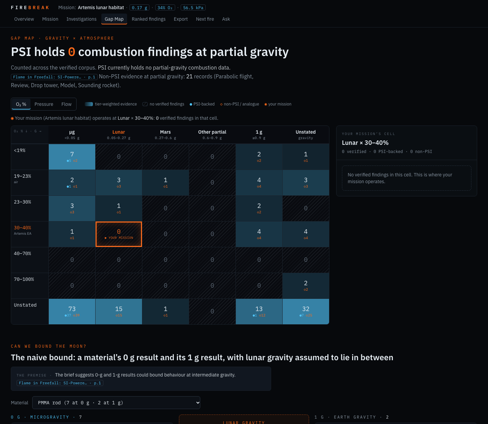
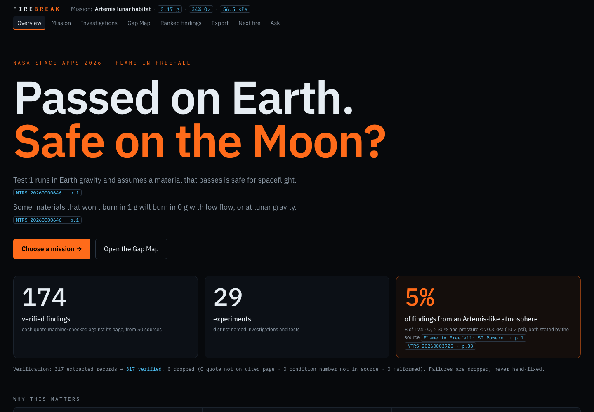
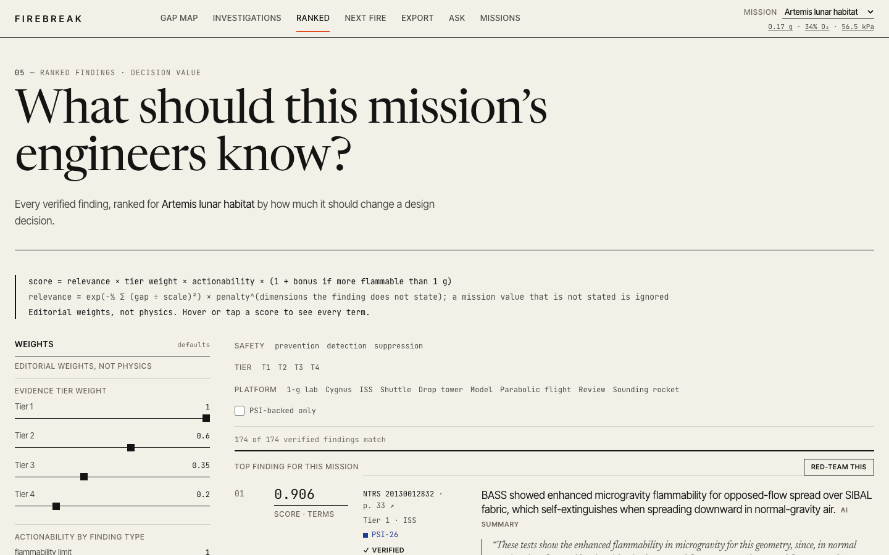
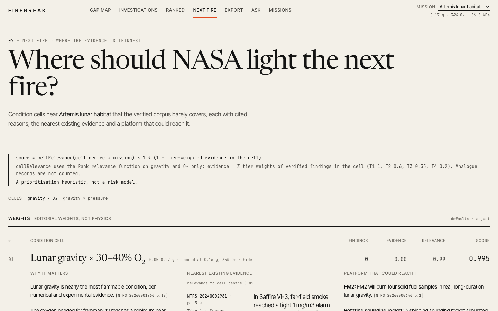
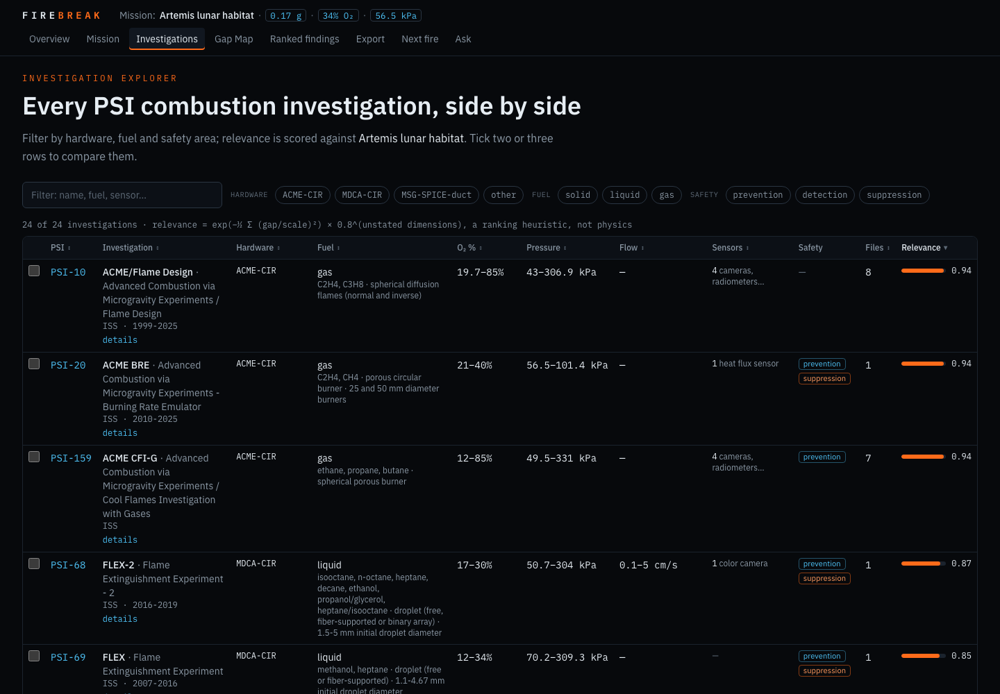
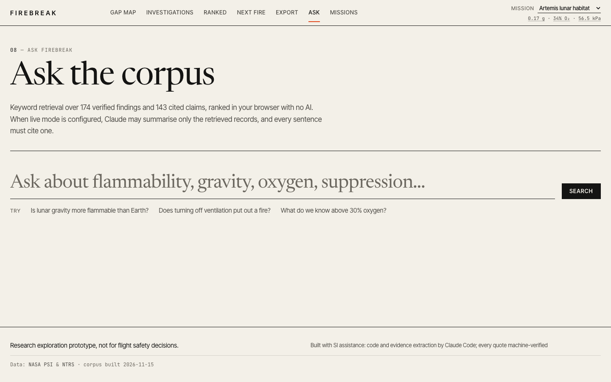
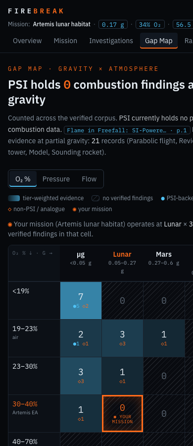

# FIREBREAK

**It passed NASA's flammability test on Earth. Will it burn on the Moon?**

FIREBREAK is a research dashboard for the NASA Space Apps 2026 challenge *Flame in Freefall*. It maps where NASA has microgravity combustion evidence, ranks it for a chosen crewed mission, and shows where NASA should light the next fire. Every number and claim is tied to a NASA source, a page and a machine-verified quote.

**Live demo:** https://firebreak-two.vercel.app

> Research exploration prototype, not for flight safety decisions.



## The problem

- NASA screens flight materials with **NASA-STD-6001 Test 1**, an upward-burning test run in Earth gravity.
- NASA Glenn researchers have argued since at least 2004 that Test 1 may not be the worst case: some materials that won't burn at 1 g burn at 0 g with a gentle airflow, or at partial gravity.
- Artemis habitats, landers and pressurized rovers plan to run at about **8.2 psia and 34% O₂** (the Exploration Atmosphere), well above the 30% O₂ where, per NASA's own reduced-pressure assessment, material flammability data become scarce.
- The challenge brief notes that **PSI currently holds no partial-gravity combustion data**, and suggests 0 g and 1 g results could bound what happens in between.

FIREBREAK's argument: you can't simply interpolate. NASA's flammability boundary is U-shaped against flow speed and gravity: flames quench at low flow and blow off at high flow, and the most flammable point lies in between. NASA researchers report that lunar gravity sits near that point. So a naive 0 g ↔ 1 g bound can underestimate the risk on the Moon. FIREBREAK shows the bound and, beside it, the cited reasons the real answer may lie outside it.

## What it does

| Screen | What it shows | Brief objective |
|---|---|---|
| Overview | The Test 1 hook, corpus statistics, and Apollo 1 / Apollo 13 / Mir as cited context | — |
| Mission | Six presets (ISS, Artemis habitat, pressurized rover, EVA suit, Mars transit, Mars habitat). Every value is cited; assumptions are labelled | 1 |
| Investigations | All 24 PSI combustion investigations with hardware, fuels, O₂ / pressure / flow ranges, sensors, safety area and data files. Pick 2–3 to compare side by side | 1 |
| Gap Map | Verified findings by gravity × O₂ (or pressure, or flow), weighted by evidence tier. Empty cells are hatched, and your mission's cell is marked. Includes the "Can we bound the Moon?" panel and a labelled schematic of the flammability boundary | 1, 2 |
| Ranked findings | A decision-value score for the chosen mission, with the formula on screen, a breakdown per finding, live weight sliders, and a filter for prevention / detection / suppression | 3 |
| Export | Filtered findings and investigations as tidy CSV / JSON with explicit units, plus a data dictionary and links to the PSI data files | 2 |
| Next fire | The empty or thin condition cells nearest your mission, ranked. Each comes with cited reasons, the nearest evidence, and a platform that could reach it | 3 |
| Ask | Keyless search over the evidence, plus an optional Claude mode that may cite only the records it is given. Includes a "Red-team this" button | — |

## How it works

```
PSI JSON API ─┐   (psi.nasa.gov/geode-py/ws/..., found by watching the PSI site's network calls)
NTRS API ─────┼─> data/raw/   cached records, PDFs, web pages (the demo needs no live calls)
Web pages ────┘        │
                       ▼
          scripts/extract_text.py   per-page text (PyMuPDF), "=== PAGE n ===" markers
                       │
                       ▼
          extraction by Claude Code (main session + 4 parallel agents)
          → data/processed/candidates/*.jsonl   (quote + page + conditions as worded in the source)
                       │
                       ▼
          scripts/verify_quotes.py   THE GATE (failures are dropped, never edited)
            · schema: enums, word limits, page in range
            · quote: verbatim on the cited page, after normalising Unicode / ligatures / hyphenation / whitespace
            · numbers: every condition number (g, %O₂, kPa, cm/s) appears in the source
                       │
                       ▼
          scripts/normalize.py (unit conversion in code) → scripts/export.py → public/data/*.json
                       │
                       ▼
          Vite + React + TypeScript app (static, client-side scoring and search) on Vercel
          + optional api/ask.ts (Claude, grounded to retrieved records)
```

## Quote verification: the headline claim

**317 extracted records → 317 verified, 0 dropped** (174 findings and 143 cited claims, from 38 NTRS documents, 24 PSI investigation records and 4 web pages). The "✓ quote-verified" badge in the UI means this check passed.

Why trust a 0? The gate is strict and tested:

- `tests/test_verify.py` shows it rejects a quote with one word changed, a quote cited on the wrong page, an invented condition number, invented wording ("Venusian gravity"), quotes with ellipses, and quotes over 40 words. That last test caught a weakness in our own checker during the build; we tightened the rule and re-ran the whole corpus.
- `tests/test_data.py` re-verifies every exported quote from scratch. It also checks that no condition is ever invented: a number exists only if the source states that condition, and it must equal the code's conversion of the source's own wording.
- `scripts/spot_check.py` is independent of the text pipeline. It searched 10 random quotes directly on their PDF page with PyMuPDF and found **10/10**.
- The extraction agents copied quotes by slicing them out of the page text instead of retyping them, which is why nothing failed.

Corpus mix:

- **Findings by evidence tier:** 52 long-duration flight (tier 1) · 32 short-duration flight (tier 2) · 28 1-g lab (tier 3) · 62 model / review (tier 4).
- **Gravity:** zero PSI-backed findings at partial gravity. The lunar-gravity evidence comes from parabolic flights, a rotating sounding rocket, centrifuge drop tests and reviews.
- **Atmosphere:** only 8 of 174 findings were tested at Artemis-like conditions (at least 30% O₂ and at most 70.3 kPa).

## Conventions

- `null` means the source doesn't state it. It shows as "—", never as 0, and is an empty cell in CSV exports.
- Canonical units: gravity in g, O₂ in % by volume, pressure in kPa, flow in cm/s. Conversions are code-only (`scripts/normalize.py`):
  - microgravity → 0 g, lunar gravity → 1/6 g, Martian gravity → 0.38 g, normal gravity → 1 g
  - "air" → 20.9% O₂
  - "quiescent" → 0 cm/s
  - ranges and lists stay `null`
- **Evidence tiers** follow where the data came from: 1 long-duration flight (ISS, Cygnus) · 2 short-duration flight (sounding rocket, parabolic, drop tower) · 3 1-g lab · 4 model or review.
- **Decision value** = relevance to mission × tier weight × actionability × (1 + bonus if the source says more flammable than 1 g).
  - Relevance = exp(−½ Σ wᵢ (Δᵢ / sᵢ)²) × 0.8^(number of unknown conditions).
  - All weights are **editorial and adjustable on screen, not physics**.

## Run it

```bash
# data pipeline (Python 3.12; uv recommended)
uv venv --python 3.12 .venv && uv pip install --python .venv/bin/python pymupdf requests beautifulsoup4 pytest jsonschema
.venv/bin/python scripts/fetch_psi.py                 # PSI records + experiment tables
.venv/bin/python scripts/fetch_ntrs.py ids <ids...>   # NTRS metadata + PDFs (see data/processed/corpus_plan.json)
.venv/bin/python scripts/extract_text.py
.venv/bin/python scripts/fetch_web.py
.venv/bin/python scripts/build_investigations.py
.venv/bin/python scripts/verify_quotes.py && .venv/bin/python scripts/export.py
.venv/bin/python -m pytest -q

# app
npm install
npm run dev        # http://localhost:5173
npm test           # vitest
npm run build
```

Deploy: `npx vercel build --prod && npx vercel deploy --prebuilt --prod`.

### Optional live AI mode

The Ask page works without any key, using client-side MiniSearch retrieval. To turn on Claude answers:

1. In the Vercel project settings, add the environment variable `ANTHROPIC_API_KEY`. The function also accepts `claudeapikey`, the name the deployed project uses.
2. Redeploy.

How live mode behaves:

- **Model:** `api/ask.ts` calls `claude-opus-5-5` with server-side refusal fallbacks enabled (`fallbacks: "default"`).
- **Grounding:** the browser sends only record ids. The server loads those records from the deployed data, so nobody can inject their own "evidence". Any answer sentence that doesn't cite one of the given ids is removed (`api/_lib/grounding.ts`, tested in `src/lib/__tests__/grounding.test.ts`).
- **No evidence:** if the records don't answer the question, it says "No NASA evidence found in our corpus."
- **Cost:** it is a public endpoint billed to your key. Answers are capped at about 150 words, but turn the key off after judging.

## Limitations

- **Corpus size:** 38 NTRS documents, 24 PSI records and 4 web pages. This is a curated slice, not all of NASA's combustion literature.
- **What the gate checks:** quotes and condition numbers are machine-verified. The AI-written summaries and the labels (tier, direction, safety area, finding type) are LLM judgments checked by spot review, not by the gate.
- **Unreadable sources:**
  - One FLEX paper (NTRS 20120016855) has text scrambled by its font encoding.
  - The ACME overview (NTRS 20220015583) is image-only.
  - SoFIE is not yet in PSI.
  - Five PSI analysis-study records give no condition ranges.
- **Mission presets:**
  - The Mars transit cabin atmosphere is unknown in our corpus, so it is left blank.
  - The Mars habitat is assumed to use the Exploration Atmosphere.
  - The EVA suit preset assumes lunar-surface gravity.
  - The pressurized rover uses the brief's band (≥30% O₂, ≤10.2 psi); NASA's nominal value is 8.2 psia / 34% (Ferkul et al. 2026).
- **Schematic only:** the flammability-boundary inset is not plotted from data.

## AI-use disclosure

- **Code:** written with Claude Code (Claude Opus 5.5): the pipeline, the app, the tests and the deployment.
- **Extraction:** done by Claude Code, in the main session plus four parallel agents (PSI records; partial gravity; atmospheres and BASS; Saffire, FLEX and smoke), following `docs/EXTRACTION.md`.
- **What was verified, and how:** every quote, page and condition number passed `scripts/verify_quotes.py`. Unit conversions are done in code. Ten random quotes were re-found on their PDF pages by an independent search.
- **Labelling in the app:** the one-line finding summaries are AI-written and labelled "AI summary". Live-mode answers are labelled as AI-generated and cite record ids.
- **Human role:** the team lead set the research question, the scope and the review checkpoints, and approved the data before deployment.

## Tests

54 pytest tests (unit conversion, the quote gate, exported-data contract) and 126 vitest tests (scoring, bins, null rendering, export CSV, next-fire ranking, search, red-team, live-mode grounding) pass. Run `.venv/bin/python -m pytest -q` and `npm test`.

## Screenshots

| Overview | Ranked findings | Next fire |
|---|---|---|
|  |  |  |
| **Investigations** | **Ask** | **Phone** |
|  |  |  |

## Team

*Team name and members to be added.*

## References

See [REFERENCES.md](REFERENCES.md). `scripts/export.py` regenerates it from the corpus, with every NASA source plus the libraries used and their licences. PSI data are CC0-1.0.
